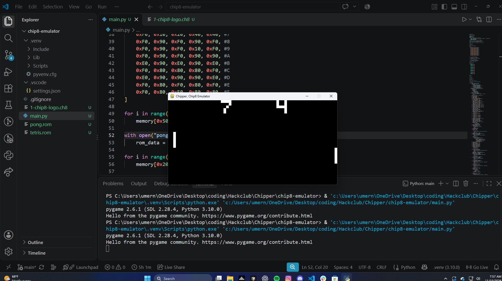
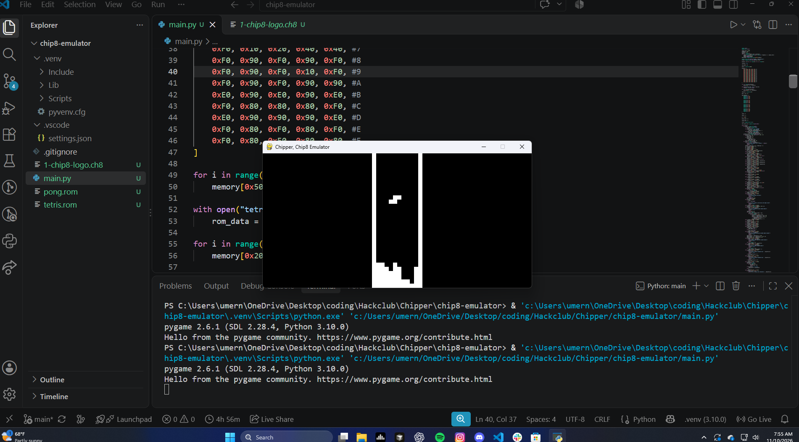

Chipper Project, CHIP-8 Emulator

Chipper is a CHIP-8 interpreter/emulator project which I made using Python and Pygame, recreating the CHIP-8 virtual machine. I implemented the CHIP-8 instruction set, made the display 64×32, added 4 KB of memory, ROM loading, and various other features to create a basic CHIP-8 emulator.

I tested the emulator using pong.rom and tetris.rom, both taken from badlogic, who has uploaded various ROMs for the CHIP-8. The controls use the standard CHIP-8 keyboard layout, using the 1 2 3 4 Q W E R A S D F Z X C V keys on the keyboard.

To install this, you must have Python 3.10 or newer and Pygame 2.6.1. Simply clone the repository, install Pygame, and run the emulator.

If I had more time for the project, I could easily have added more fancy functions, but due to the fact that I started the project late, I barely completed 10 hours for this project. But it will all be worth it in the end.

## Screenshot Pong

## Screenshot Tetris

## Author
Built by Mesaki1906 as a part of the Hack Club Chipper Project.
